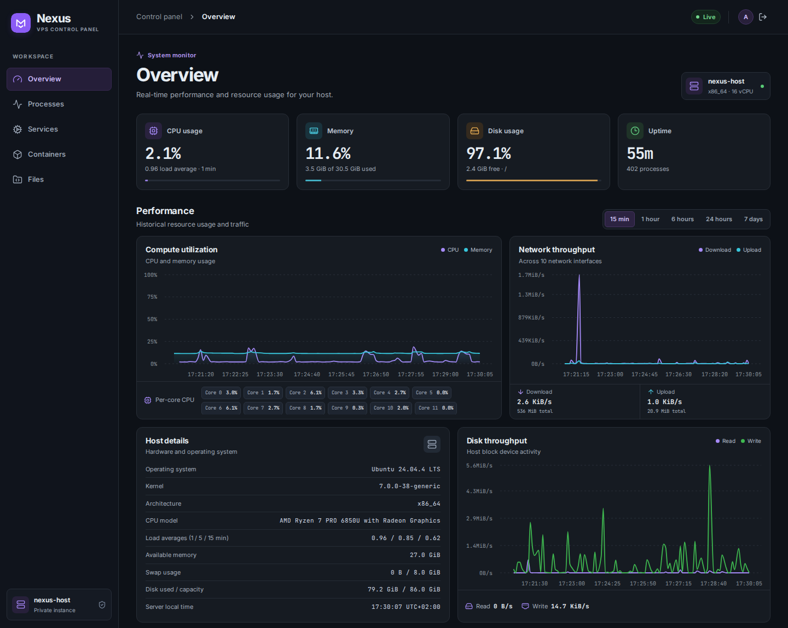

# Nexus

Nexus is a private Linux VPS control panel with live host metrics, read-only process and service monitoring, optional Docker monitoring, and a workspace-scoped code editor. One FastAPI process serves the compiled React application, runs the metrics collector, and stores state in SQLite. Ubuntu 24.04 on ARM64 is the deployment target.



[Mobile dashboard](docs/mobile.png) · [Mobile editor](docs/mobile-editor.png)

The dashboard preview uses local Ubuntu measurements and an anonymized hostname. The editor preview uses a disposable test workspace.

## Deploy on Ubuntu 24.04

Use a trusted copy of this repository. For the lightweight VPS, build the frontend on another machine with Node.js 22 or newer and copy the repository with the resulting `frontend/dist` to the VPS. The frontend output is architecture-independent.

```bash
cd frontend
npm ci
npm run build
cd ..
```

From the repository on the VPS, run the following as your regular administrator.

```bash
sudo apt-get update
sudo apt-get install -y python3 python3-venv
./deploy/install.sh
```

If Node.js is already installed on the VPS, `./deploy/install.sh --build` builds and installs in one step. The installer makes a versioned release under `/opt/nexus/releases`, creates the unprivileged `nexus` account, and installs the unit. Existing Nexus state lives under `/var/lib/nexus` and configuration under `/etc/nexus`. The installer preserves those directories across releases.

### Private HTTPS with Tailscale Serve

Join the VPS and your client device to your tailnet. Enable MagicDNS and HTTPS certificates and grant the intended devices access to the VPS in your tailnet policy. See the [Tailscale Serve documentation](https://tailscale.com/docs/reference/tailscale-cli/serve).

These commands use port 8443 so Nexus can coexist with an existing Serve configuration. Check the status for the selected port first.

```bash
sudo tailscale serve status
tailscale status --json | python3 -c 'import json,sys; print(json.load(sys.stdin)["Self"]["DNSName"].rstrip("."))'
sudoedit /etc/nexus/nexus.env
```

Set `NEXUS_ORIGIN=https://<dns-name-from-above>:8443` with the actual DNS name and no trailing slash. Keep `NEXUS_DEVELOPMENT=false`. Optionally change `NEXUS_ADMIN_NAME` and set `NEXUS_NETWORK_INTERFACES` to a JSON list with the VPS uplink name.

Create the administrator password, start the app, and configure the private proxy.

```bash
sudo -u nexus sh -c 'umask 077; cd /opt/nexus/current && .venv/bin/python -m alembic upgrade head && exec .venv/bin/python -m nexus.cli set-password'
sudo systemctl enable --now nexus.service
sudo tailscale serve --bg --https=8443 http://127.0.0.1:8765
sudo tailscale serve status
systemctl status nexus.service
```

Open the HTTPS URL reported by Serve from a device on the tailnet and sign in. FastAPI listens on `127.0.0.1:8765`. Retain Serve's tailnet-only audience. To rotate the administrator password, rerun the protected `nexus.cli set-password` command. Rotation revokes existing sessions.

### Authorize a workspace

The example creates a new project directory. For an existing project, approve its exact canonical path and arrange permissions for that directory explicitly. Atomic saves need write and search permission on its containing directories, and the service account must be able to preserve the original file's ownership and POSIX access ACL.

```bash
sudo install -d -m 0755 -o root -g root /srv/nexus-workspaces
sudo install -d -m 0750 -o nexus -g nexus /srv/nexus-workspaces/projects
sudoedit /etc/nexus/workspaces.toml
```

```toml
[workspaces]
projects = "/srv/nexus-workspaces/projects"
```

Run `sudo systemctl edit nexus.service` and add one pair of entries for each authorized workspace. This bind-mounts the root inside the service's private mount namespace and allows writes through the otherwise read-only systemd policy.

```ini
[Service]
BindPaths=/srv/nexus-workspaces/projects
ReadWritePaths=/srv/nexus-workspaces/projects
```

```bash
sudo systemctl restart nexus.service
```

Use dedicated workspaces with trusted local co-writers. Keep credentials, deployment keys, and privileged service definitions outside them. Kernel-enforced write restrictions require Linux Landlock ABI 3 or later (Linux 6.2+). See the [Landlock documentation](https://docs.kernel.org/userspace-api/landlock.html). Nexus also uses `openat2` to pin and resolve workspace paths with symbolic links and child mounts disabled. The backend rejects hard-linked files, special files, hidden paths, common credential names, private-key extensions and known private-key headers.

The editor supports UTF-8 text. It preserves a file's uniform line endings and discloses normalization when a file has mixed endings. Saves preserve the existing owner, group, ordinary permission bits, and POSIX access ACL when the filesystem allows it. They synchronize a sibling temporary file, commit a preimage to SQLite, then atomically replace the original. File deletion requires confirmation and is recoverable while its revision is retained. Directory deletion is limited to empty directories. A save validates the loaded content hash and checks file and directory identity again before replacement. Plan edits with any external writer that modifies the same files in the final rename window.

### Monitor services

Set `NEXUS_SERVICES` in `/etc/nexus/nexus.env` to an explicit JSON array of literal names, for example `["nexus.service"]`. Restart Nexus to apply it. The panel uses fixed read-only `systemctl show` and `journalctl` requests. Journal access can be broader than the application's allowlist at the operating-system layer, so the installer leaves group memberships unchanged. The UI reports when journal reads are unavailable.

### Enable optional Docker monitoring

From the prepared repository on a VPS with a local Docker Engine, run the following. The collector supports Engine API 1.41 or newer for one-shot stats.

```bash
./deploy/install.sh --docker
sudoedit /etc/nexus/nexus.env
sudoedit /etc/nexus/docker.env
sudo systemctl enable --now nexus-docker.service
sudo systemctl restart nexus.service
```

Set `NEXUS_DOCKER_ENABLED=true` in `nexus.env`. Optionally set `NEXUS_DOCKER_LOG_NAMES="app worker"` in `docker.env` with exact container names. Restart both sides after changing the log allowlist.

```bash
sudo systemctl restart nexus-docker-gate.service nexus-docker.service
```

The Docker SDK collector receives a private socket with a fixed read-only API. It publishes bounded snapshots to `/run/nexus-docker` for FastAPI. The socket-activated gate alone has direct Docker Engine access and must be trusted as a Docker-privileged component. It accepts version, container list, projected container metadata, one-shot stats, and bounded logs for explicit names. The collector shows up to 16 containers per snapshot. Metrics can be absent for stopped containers, and logs depend on each container's log driver. With Docker disabled, these optional units stay idle and FastAPI requires no Docker packages or socket access. See [Docker Engine security](https://docs.docker.com/engine/security/).

## Metrics and storage

- One sampler runs every four seconds by default, even with zero connected browsers. A WebSocket sends the newest sample to each signed-in client. The browser detects stale connections and reconnects with backoff.
- SQLite receives a sample every 20 seconds by default. History ranges include 15 minutes, 1 hour, 6 hours, 24 hours, and 7 days. Raw data rolls into five-minute averages after 30 hours and expires after eight days by default. The API downsamples separately for each range.
- Throughput is computed from monotonic elapsed time and per-device counter differences. Initial readings, reset counters, and device changes may produce gaps. Disk capacity uses `NEXUS_DISK_PATH`. Disk throughput uses host block devices and may include both layers of stacked storage. Network totals sum non-loopback interfaces unless `NEXUS_NETWORK_INTERFACES` names specific interfaces.
- The process view samples on demand, shares a three-second cache across clients, and pages results at the API. Process CPU percentages are expressed relative to one logical core.
- By default Nexus retains 20 revisions per path, up to 128 MiB and 10,000 revisions in total. File audit events are retained for up to 90 days or 50,000 entries. SQLite reuses pages released by retention. A directory listing returns up to 300 entries; filename search visits up to 128 folders and 4,000 entries per request.

An idle 60-second measurement on Ubuntu 24.04 x86-64, with the app restricted to two logical CPUs and Docker off, recorded 77.02 MiB peak RSS, 62.17 MiB median PSS, and 0.22% average CPU relative to one core. This measurement used the default sampler and no connected clients. On the VPS, use:

```bash
sudo python3 deploy/measure.py "$(systemctl show -p MainPID --value nexus.service)" --seconds 60
```

## Back up and recover

SQLite contains password hashes, sessions, audit metadata, and copies of editable files. Protect backups as carefully as the workspaces themselves. To get a consistent offline backup, stop Nexus and coordinate with any other processes writing to your workspaces. The following commands use the example workspace layout. Include any additional workspace directories and the systemd workspace drop-in if configured.

```bash
sudo install -d -m 0700 /var/backups/nexus
sudo systemctl stop nexus.service
sudo sh -c 'umask 077; tar -C / -cpf "/var/backups/nexus/nexus-$(date -u +%Y%m%dT%H%M%SZ).tar" etc/nexus var/lib/nexus srv/nexus-workspaces'
sudo systemctl start nexus.service
```

For an online database-only backup, use SQLite's backup API. Keep workspace backups separate.

```bash
sudo python3 - <<'PY'
import os
import sqlite3
from contextlib import closing
from datetime import UTC, datetime
from pathlib import Path

os.umask(0o077)
folder = Path("/var/backups/nexus")
folder.mkdir(mode=0o700, parents=True, exist_ok=True)
stamp = datetime.now(UTC).strftime("%Y%m%dT%H%M%SZ")
with closing(sqlite3.connect("file:/var/lib/nexus/nexus.sqlite3?mode=ro", uri=True)) as source:
    with closing(sqlite3.connect(folder / f"nexus-{stamp}.sqlite3")) as backup:
        source.backup(backup)
PY
```

Use **Files → Revisions** to restore a particular saved or deleted file. For whole-instance recovery, reinstall the corresponding release, stop the app, and unpack a trusted archive into an isolated staging directory. Verify the paths and SQLite integrity, move the current state aside, then restore the staged database, configuration, and required workspace files. Preserve or reapply the `nexus` owner and mode `0700` on `/var/lib/nexus`. Restore workspace ownership and any systemd drop-in, reload systemd, and start Nexus. Rotate the password after restoration to invalidate sessions from the backup.

An audit entry marked `pending` or `uncertain` calls for checking the file on disk and comparing the retained preimage. A power loss may leave a hidden `.nexus-*` temporary file. Review any such file locally with the service stopped before removing it.

## Development

Requirements are Linux with Landlock and `openat2`, Python 3.12+, and Node.js 22 or newer. Install [uv](https://docs.astral.sh/uv/getting-started/installation/) or use an equivalent virtual environment workflow.

```bash
uv sync --locked --extra dev
cp .env.example .env
cp config/workspaces.example.toml config/workspaces.toml
```

Set these two values in `.env` for Vite development. Add a disposable workspace to the TOML file if testing the editor.

```dotenv
NEXUS_ORIGIN=http://127.0.0.1:5173
NEXUS_DEVELOPMENT=true
```

```bash
uv run alembic upgrade head
uv run python -m nexus.cli set-password
uv run python -m nexus
```

In a second terminal:

```bash
cd frontend
npm ci
npm run dev
```

Browse to `http://127.0.0.1:5173`. Vite proxies API and WebSocket requests to FastAPI. Development permits HTTP and non-Secure cookies only for loopback origins. For a compiled build with Vite off, use an origin matching the actual browser entry point. Production expects HTTPS.

### Checks

Run these from the repository root after syncing the Python dependencies.

```bash
uv run ruff check .
uv run pytest -q
npm --prefix frontend run lint
npm --prefix frontend run typecheck
npm --prefix frontend run test
npm --prefix frontend run build
cd frontend
npx playwright install chromium
npm run test:e2e
```

Playwright starts a disposable HTTPS instance on loopback port 8875 with a test password, scratch workspace, and temporary certificate. It exercises real authentication, WebSocket data, the responsive interface, and editor writes. OpenSSL is required for its certificate fixture.

## Repository layout

| Path | Purpose |
| --- | --- |
| `nexus/routes/` | Authenticated API and live WebSocket |
| `nexus/auth.py`, `nexus/config.py`, `nexus/schemas.py` | Sessions, environment configuration, and request validation |
| `nexus/metrics.py`, `nexus/background.py`, `nexus/monitoring.py` | Host sampling, lifecycle, and read-only monitors |
| `nexus/filesystem.py`, `nexus/landlock.py` | Workspace access, file transactions, and kernel policy |
| `nexus/repositories.py`, `nexus/models.py`, `migrations/` | SQLite stores, schema, and Alembic revisions |
| `nexus/docker_collector.py`, `nexus/docker_gate.py` | Optional SDK collector and restricted Engine gateway |
| `frontend/` | React, Tailwind, shadcn/ui primitives, Recharts, and lazy CodeMirror |
| `deploy/` | Installer, pinned requirements, service units, and resource measurement |
| `tests/`, `frontend/e2e/`, `docs/` | Automated coverage and interface previews |

## Operating boundaries

Nexus is a single-administrator private application. The state database and allowed files must be on filesystems with dependable local locking and atomic rename semantics. Filename policies cannot identify credentials embedded in arbitrary source or log entries. Keep sensitive material out of workspaces and enable logs deliberately. An editor account can change source that another process later executes, so use least-privilege service accounts for those projects. Retention limits are configurable through `.env.example`.

The statically served web app has no shell, process-kill endpoint, service controls, Docker mutation endpoints, or broad filesystem access. Test the ARM64 service and tailnet permissions on the deployment VPS.
